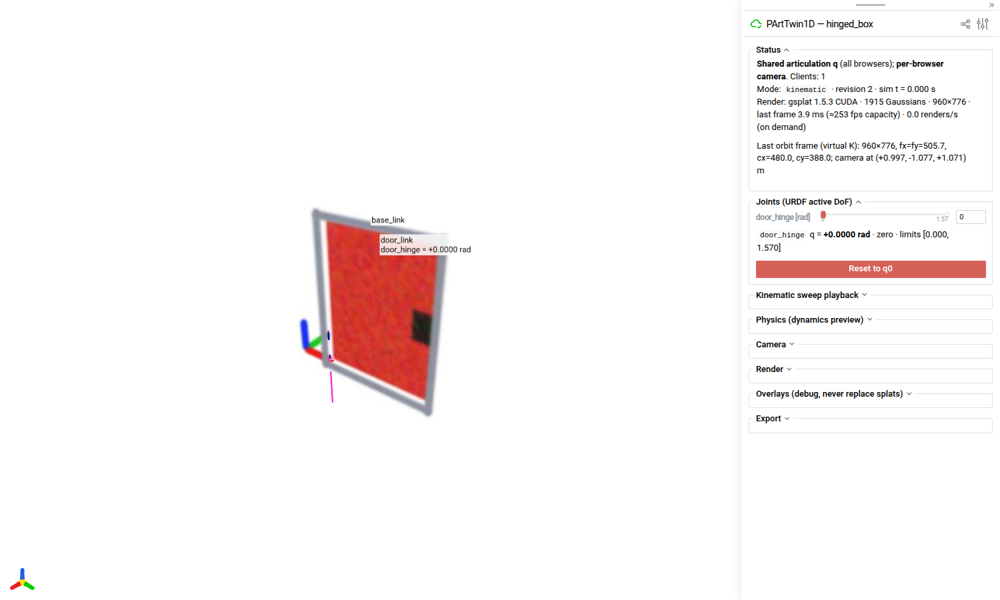
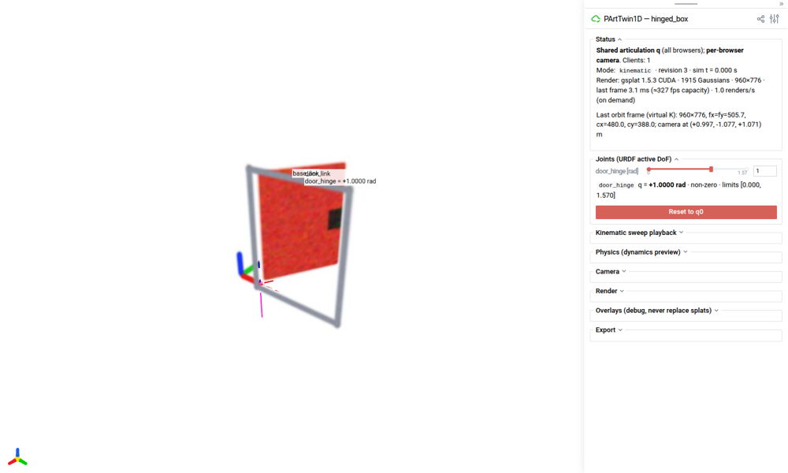
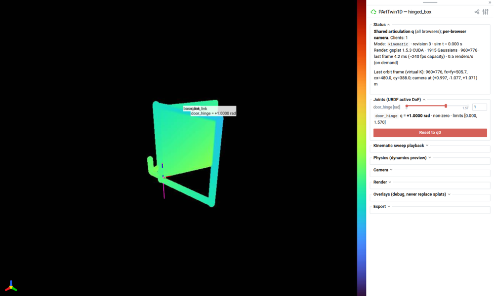
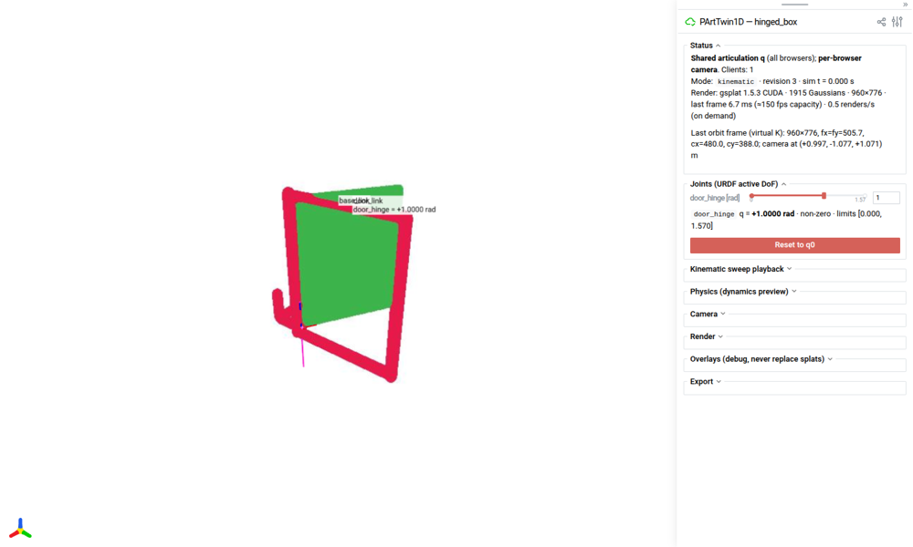
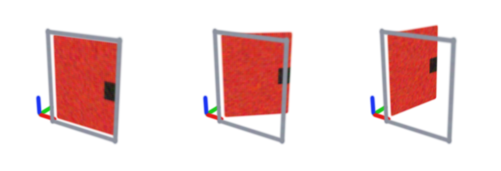
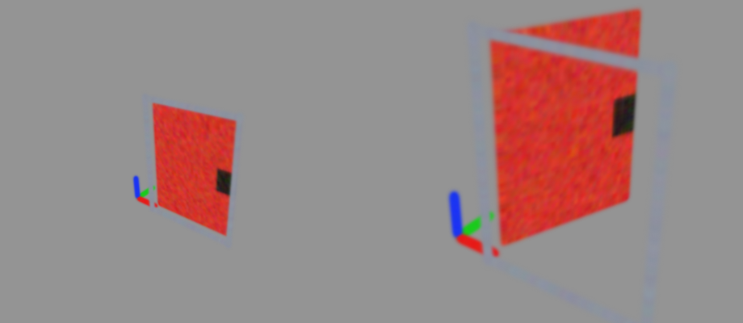

# Implementation report — repository refactor, pinned submodules, ManiSkill × 3DGS, live 3D GUI

Date: 2026-11-16 · Branch: `feature/maniskill-3dgs-gui` · Workstation: RTX 4070 Laptop (SM 8.9, 8 GB),
driver 580.178.04, conda env `parttwin_sim` (Python 3.11.18, torch 2.11.0+cu128, SAPIEN 3.0.3).
All results below were observed on this machine; logs are in `outputs/logs/` (gitignored run artefacts).

---

## 1. Before (audit)

State found: only `README.md` tracked on `main`; all pre-refactor work (`parttwin1d/sim/*`, `scripts/*`,
`tests/*`, `configs/*`) untracked, plus a stray archive `e .zip`. It was committed unchanged as the
audit baseline `3f2efe1` before any move.

### 1a. Root `pytest` collection failure — `parttwin_smoke`

* `tests/test_sh_directions.py:7-9`, `tests/test_transforms.py:4,7`, `tests/test_robotless_env.py:54,92`
  imported `parttwin_smoke`, a package from the v2/v3 smoke ZIPs that no longer existed in the repo.
* The env still had the editable distribution `parttwin-maniskill-gs-smoke 0.3.0`
  (`__editable___parttwin_maniskill_gs_smoke_0_3_0_finder.py`, `MAPPING = {'parttwin_smoke':
  '/home/samuelemara/PArtTwin1D/parttwin_smoke'}` → a non-existent path; older copies sit in
  `~/.local/share/Trash/files/{parttwin_smoke,parttwin_maniskill_gs_v2,…}`), so
  `ModuleNotFoundError: No module named 'parttwin_smoke'` at collection → *"Interrupted: 2 errors during collection"*.
* With the default shell `PYTHONPATH` (ROS Jazzy / MoveIt Python 3.12 paths), collection failed even
  earlier: ROS's `launch_testing` pytest11 plugin → `ModuleNotFoundError: No module named 'lark'`.

### 1b. The "stall" after `Loaded 1480 Gaussians across 2 URDF links` — two real, distinct failures

1. **gsplat JIT build (CUDA extension), not a deadlock.** `~/.cache/torch_extensions/py311_cu128/gsplat_cuda`
   held `gsplat_cuda.so` from 12:13 but all 20 `.cu` objects re-compiled 14:18–14:23 (ninja log), because
   `scripts/activate_sim.sh` had switched `CC/CXX` to the conda GCC 14 wrappers (command line changed ⇒
   rebuild; `MAX_JOBS=2` ⇒ minutes of nvcc with no output). `ninja -n -d explain` showed 9 host `.cpp`
   objects still dirty and the link never run. Completing the build with the same environment failed
   deterministically in **4 s, rc=1**:
   `torch/include/c10/cuda/CUDAMiscFunctions.h:7: fatal error: cuda_runtime.h: No such file or directory`
   (log: `outputs/logs/gsplat_jit_build.log`). Root cause: conda CUDA 12.8 keeps headers in
   `$CONDA_PREFIX/targets/x86_64-linux/include`; nvcc finds them via `nvcc.profile`, PyTorch only gives the
   host compiler `-isystem $CUDA_HOME/include`. The `_jit_compile()` `TypeError` printed earlier is
   gsplat's caught signature probe (`gsplat/cuda/_backend.py:93-113`), not the terminal error.
   **Fix:** `scripts/activate_sim.sh` exports `CPATH=$CONDA_PREFIX/targets/x86_64-linux/include`
   (env var ⇒ no ninja command change ⇒ cached `.cu` objects reused): incremental build **94 s, rc=0**
   (`outputs/logs/gsplat_jit_build2.log`).
2. **Rasterization call assertion.** With a working extension, the original script
   (`scripts/render_articulated.py` → `parttwin1d/sim/renderer.py:103-106`, `rasterization(...,
   render_mode="RGB+ED", backgrounds=bg, packed=True)`) prints the "Loaded 1480 Gaussians" line and then
   fails: `gsplat/cuda/_wrapper.py:598 assert backgrounds.shape == image_dims + (channels,)` →
   `AssertionError: torch.Size([1, 4])`, rc=1 after 5.4 s. Reproduced from the baseline commit in an
   isolated copy: `outputs/logs/baseline_render_articulated_repro.log`. In gsplat 1.5.3,
   `rasterize_to_pixels` derives `image_dims` from packed `means2d [nnz,2]` → `()`, so any documented
   `[C,D]` background fails. **Fix:** `packed=False` (as gsplat's own `examples/simple_viewer.py`).

### 1c. Other defects found and fixed

* Old `tests/test_maniskill_no_robot.py`, `tests/test_renderer_contract.py`, `tests/test_robotless_env.py`
  mocked ManiSkill/SAPIEN/gsplat entirely (no integration evidence).
* `set_joint_drive_targets(..., joint_indices=torch.arange(...))` on GPU PhysX: dtype mismatch in
  `get_joint_target_indices` (`int64` vs `int32`) and an unbounded cache keyed by tensor identity →
  now `joints=` on both backends (ManiSkill's recommended form).
* Implicit identity `T_link_ply`/`T_world_root` were accepted silently → now required fields.

## 2. After

### 2a. Tree (created / moved)

```
.gitmodules                          third_party/{ManiSkill,gsplat,nerfview}  (submodules)
Makefile  pyproject.toml (parttwin1d 0.4.0, src layout, `parttwin` entry point, pytest config)
src/parttwin1d/
  __init__.py  _pins.py
  config/{schema,loader,validate}.py
  assets/{gaussian_ply,urdf,frame_alignment}.py        (gaussian_ply.py ← git mv parttwin1d/sim/assets.py)
  geometry/{se3,cameras}.py                             (se3.py ← git mv parttwin1d/sim/geometry.py)
  sim/{env,articulation,state}.py                       (env.py ← git mv parttwin1d/sim/env.py)
  rendering/{gaussians,link_adapter,gsplat_backend,cameras,observations}.py
                                                        (gsplat_backend.py ← git mv parttwin1d/sim/renderer.py)
  viewer/{server,render_callback,controls,overlays,coordination}.py
  evaluation/{consistency,profiling}.py
  cli/{__init__,doctor,inspect,render,gui}.py           (doctor/inspect/render ← git mv scripts/*.py)
configs/examples/hinged_box.yaml  configs/real_object.template.yaml  configs/gui.defaults.yaml
examples/hinged_box/{model.urdf,base.ply,door.ply,generate_fixture.py}  examples/demo_articulated.py
tests/{conftest.py, unit/*, integration/*, gui/*}
scripts/{activate_sim.sh,bootstrap_submodules.sh,check_environment.sh,test.sh,test_gpu.sh,run_gui.sh,capture_gui_evidence.py}
requirements/{runtime.in,gui.in,dev.in,environment.lock.md}
docs/{architecture,installation,coordinate_frames,urdf_and_gaussians,gui,testing,third_party,IMPLEMENTATION_REPORT}.md, docs/images/
assets/{README.md,.gitkeep}
legacy/experiments/{MANIFEST.md, tests/, scripts/, docs/, fixtures/, quarantine/SHA256SUMS}
```

The production namespace is only `parttwin1d`; `legacy/` is not importable and not collected.

### 2b. API boundaries

* `config.load_config(path) -> ObjectConfig` (YAML/JSON, schema v1, unknown keys rejected, paths relative to the file).
* `sim.env.create_env(cfg, backend)` → robot-free `ArticulatedTwinEnv`; `sim.articulation.ArticulationDriver`
  (`set_q_kinematic`, `set_joint_kinematic`, `step_dynamics(drive_target=|joint_force=)`, `snapshot()`);
  `sim.state.StateSnapshot` (immutable) and `link_poses_tensor(env, links) -> [B,L,4,4]` on device.
* `rendering.gsplat_backend.ArticulatedGaussianRenderer`: `from_config`, `bind_articulation`,
  `update_from_snapshot`, `render(camera) -> RenderResult`, `render_batch`, `render_observation(snapshot, cameras)`.
* `rendering.observations.export_result / load_export` (the only GPU→CPU export path).
* `viewer.server.GuiApp` (+ `viewer.coordination.SimulationCoordinator`).

### 2c. Submodules and provenance

| Submodule | URL | Pinned SHA | Version | License |
|---|---|---|---|---|
| `third_party/ManiSkill` | https://github.com/mani-skill/ManiSkill.git | `a4a4f9272ad64b1564035874b605ceb687b63ed8` | v3.0.1 | Apache-2.0 |
| `third_party/gsplat` | https://github.com/nerfstudio-project/gsplat.git | `937e29912570c372bed6747a5c9bf85fed877bae` | v1.5.3 | Apache-2.0 |
| ↳ nested `glm` | https://github.com/g-truc/glm.git | `2d4c4b4dd31fde06cfffad7915c2b3006402322f` | (gsplat pin) | MIT |
| `third_party/nerfview` | https://github.com/nerfstudio-project/nerfview.git | `4538024fe0d15fd1a0e4d760f3695fc44ca72787` | 0.1.2 (+3) — the commit gsplat v1.5.3 pins | MIT per `pyproject.toml` (no LICENSE file at this commit; upstream later added Apache-2.0) |

Runtime mode **`source`** (one mode, no mixing): `parttwin doctor --provenance --check-gsplat` →
`mani_skill … ← third_party/ManiSkill/mani_skill/__init__.py`, `gsplat … ← third_party/gsplat/gsplat/__init__.py`,
`nerfview … ← third_party/nerfview/nerfview/__init__.py`, all `pin OK`, CUDA extension
`~/.cache/torch_extensions/py311_cu128/gsplat_cuda/gsplat_cuda.so` loaded, nvcc 12.8.93, torch CUDA 12.8,
SM 8.9, **verdict: COMPATIBLE** (`outputs/logs/final_doctor.log`, `outputs/logs/doctor.json`).
Before switching, the installed wheels were diffed against the tags: gsplat byte-identical; ManiSkill
Python modules identical. The source switch cost one gsplat JIT rebuild: **252 s** (rc=0), warm import 2.5 s.
Torch, SAPIEN, NumPy and the CUDA toolkit were not reinstalled. Env delta (`pip freeze` before/after):
removed `parttwin-maniskill-gs-smoke`; wheels `gsplat`/`mani_skill` → editable submodules; added
`nerfview` (editable), `viser 1.1.1`, `splines 0.3.3`, `msgspec`, `websockets`, `zstandard`,
`playwright 1.65.2`, `greenlet`; `rich 15.0.0 → 14.3.4` (viser pin). `pip check`: clean.

## 3. Tests (all commands from `~/PArtTwin1D` after `source scripts/activate_sim.sh`)

| Command | Result | Exit | Wall | Evidence |
|---|---|---|---|---|
| `python -m pytest -q` | **71 passed, 39 skipped** (opt-in tiers) | 0 | 8.6 s | `outputs/logs/final_pytest_root.log` |
| same, with ROS Jazzy + MoveIt `PYTHONPATH` exported and plugin autoload **on** | 71 passed, 39 skipped — collects cleanly | 0 | 6.8 s | session log |
| `bash scripts/bootstrap_submodules.sh` (re-run, idempotent) | editable installs, `pip check` clean, doctor COMPATIBLE | 0 | — | `outputs/logs/bootstrap_rerun.log` |
| `python -m parttwin1d.cli.doctor --provenance --check-gsplat` | COMPATIBLE, mode `source` | 0 | 4.7 s | `final_doctor.log` |
| `python -m parttwin1d.cli.inspect --config configs/examples/hinged_box.yaml` | 0 errors, 0 warnings | 0 | 0.5 s | `final_inspect.log` |
| `PARTTWIN_RUN_GPU_TESTS=1 python -m pytest -v tests/integration` | **28 passed** | 0 | 34.2 s | `final_integration.log` |
| `python -m parttwin1d.cli.render … --frames 20 --out outputs/hinged_box` | 20 frames × 2 cameras | 0 | 10.1 s | `final_render.log`, `outputs/hinged_box/report.json` |
| `PARTTWIN_RUN_GUI_TESTS=1 python -m pytest -v tests/gui` | **12 passed** (incl. latency guard) | 0 | 50.0 s | `final_gui_tests.log`, `outputs/test_artifacts/gui_*.png` |
| `python -m parttwin1d.cli.gui --config … --port 8080` (manual) | served, Ctrl+C → "shut down cleanly" | 0 | — | `outputs/logs/gui_manual.log` |

### 3a. Unit tests (CPU) — 71 PASS

| File | # | Mocking |
|---|---|---|
| `test_se3.py` | 14 | none (inverse/compose, covariance vs quaternion composition `R(q_wp⊗q_g)=R_wp R_g`, 180° quats, reflections/scale rejected) |
| `test_cameras.py` | 6 | none (optical axes ±, `fx≠fy`, `cx≠W/2`, skew rejected, virtual K == `nerfview.CameraState.get_K`) |
| `test_ply.py` | 12 | none (degrees 0–3 round trip, channel-major `f_rest`, log-scale/logit activation, zero quaternion, point cloud rejected) |
| `test_asset_schema.py` | 21 | none (CWD-independent paths, 14 invalid-config cases, URDF bindings, collision-containment alignment ≥99 %, capture-world algebra) |
| `test_imports.py` | 5 | none (namespace, no smoke/Trash, lazy SAPIEN import, root `pytest --collect-only`) |
| `test_splat_link_pose.py` | 5 | one test patches the SH kernel to capture directions |
| `test_coordination.py` | 8 | **stand-in driver** (threading/coalescing only) |

### 3b. Physical ManiSkill/SAPIEN tests (real PhysX) — 14 PASS (7 × `physx_cpu`, 7 × `physx_cuda`)

Non-identity `T_world_root` (yaw 0.6 rad, t = (0.3, −0.2, 0.15)). Measured (`outputs/test_artifacts/physx_checks_*.json`):

| Quantity | physx_cpu | physx_cuda | bound |
|---|---|---|---|
| door rotation error vs analytic hinge (6 q values) | 2.3e-7 rad | 4.7e-7 rad | < 1e-4 |
| door translation / pivot drift | 1.1e-7 m | 2.2e-7 m | < 1e-5 |
| fixed base deviation | 0 | 0 | < 1e-6 |
| root pose error (after reset and reconfigure) | 1.4e-8 | 1.4e-8 | < 1e-5 |
| kinematic preview sim time | 0 s | 0 s | = 0 |
| PD drive to 1.2 rad, 2.0 s | q = 1.1880 | q = 1.1880 | (1.0, 1.2] |
| zero input at q = 0.5 (vertical hinge) | 0 drift | 0 drift | < 1e-3 |
| +1 N·m for 0.5 s from 0.5 rad | 0.5483 | 0.5483 | > 0.501 |

Also: `agent is None`, obs `{agent: {}, extra: {qpos, qvel}}`, `get_state_dict()` without controller,
state round trip, limit violation rejected, `link_poses_tensor` `[1,2,4,4]` on `cuda:0` (GPU PhysX) matches the snapshot.

### 3c. Real gsplat CUDA tests — 12 + 2 PASS

`test_real_kernel_no_fallback`, `test_render_changes_with_joint_and_static_link_fixed` (static base world
Gaussians bit-identical, door Gaussians move > 0.3 m, return to q0 bit-identical, canonical checksum unchanged),
`test_sh_rigid_invariance[0|1|3]` (max |ΔRGB| < 2e-3), `test_world_frame_sh_would_be_wrong` (negative control > 2e-2),
`test_canonical_sh_equals_gsplat_reference_at_identity`, `test_depth_occlusion_independent_of_link_order`
(red/blue planes, both link orders, nearer plane wins and images match to 1e-4), `test_exact_principal_point_and_focal`
(cx+12/cy−7 ⇒ exact pixel shift; fy×1.5 ⇒ vertical stretch only), `test_export_roundtrip`,
`test_gui_callback_equals_offline_render` (pre-JPEG, bit-identical), `test_profile_steady_state`,
`test_render_cli_sweep[physx_cpu|physx_cuda]` (GPU PhysX + gsplat in one process).

### 3d. GUI tests in a real browser — 12 PASS (headless system Chrome 152 via Playwright, live server)

live Gaussian RGB visible in the browser canvas (red-door pixel count) · mouse orbit, right-drag pan, wheel zoom
each produce a **new** gsplat render with a new c2w (same snapshot revision); viewport resize ⇒ new virtual K ·
slider typed 0 → 1.0 → 0 → 1.0 rad and mouse-dragged: door pose matches the analytic hinge (< 1e-4 rad), base
unchanged, readout/slider synced, overlay node follows the SAPIEN pose, no drift back at 0 · Play advances q, Pause
holds q exactly, Step advances one frame · overlay toggle hides frames while splats stay rendered · error surfaced
in the GUI ("switch to dynamics mode…") with the owner thread alive · dynamics mode via dropdown + Step ×10
advances sim time · Export writes orbit + calibrated metadata (exact K `[[600,0,331.5],[0,590,236],[0,0,1]]`, c2w, q,
T_world_link) and images · calibrated panel uses exact K · two browsers: independent cameras, shared q (slider
in client 2 updates client 1's slider and both re-render), disconnect/reconnect · CLI Ctrl+C with a connected
browser ⇒ exit 0 "shut down cleanly".

Manual (human) GUI check: **NOT RUN by a human** in this session — all GUI checks above were automated in a real
browser; a hardware-accelerated desktop browser session remains for the operator (§6).

## 4. GUI

Launch: `python -m parttwin1d.cli.gui --config configs/examples/hinged_box.yaml --host 127.0.0.1 --port 8080`
→ `http://127.0.0.1:8080` (if busy, viser binds the next port and the CLI warns; on this workstation 8080 is held by
another service, so the manual run served on 8081).

| q = 0 (RGB) | q = 1.0 rad (RGB, same camera) |
|---|---|
|  |  |
| **depth (m, colorbar)** | **link ID** |
|  |  |

Offline sweep (calibrated `front_oblique`, exact K), q = 0, 0.68, 1.3 rad: 

The hinge rotates the red door about the left post (+z through the base origin, opening towards +y); the gray
frame and the RGB triad (+X red, +Y green, +Z blue up — confirming the OpenCV camera convention without any
extra flip) stay fixed. Known limitations: orbit view uses a virtual K (fx = fy, centred principal point), exact
calibrated K is in the Calibrated view panel and exports; frames are JPEG for transport; the software-WebGL toast in
headless/VM browsers concerns only the browser's overlay drawing.

## 5. Measurements (synthetic hinged box, 1 915 Gaussians: base 385 + door 1 530, SH degree 3)

| Item | Value |
|---|---|
| Scene setup (ManiSkill robot-free env + reset) | 3.0 s |
| PLY load + GPU upload | 0.26 s |
| gsplat JIT compile (one-time, source paths) | 252 s; warm extension import 2.5 s |
| First rasterization in a process (CUDA lazy init) | 106 ms |
| Steady state 640×480, 1 camera | median 1.25 ms (≈800 fps), p95 1.27 ms, peak GPU mem 26.9 MB |
| Steady state 640×480 + link-ID channels | median 1.46 ms (≈685 fps), peak 33.8 MB |
| Steady state 1280×960 | median 1.91 ms (≈523 fps), peak 62.0 MB |
| GUI frame (960×776 incl. device→host copy, colouring) | 3–7 ms per render; delivered via JPEG websocket |
| GUI orbit latency, camera update → frame sent (real Chrome drag) | **11.6 ms median / 15.4 ms p90 at 960×853** (follow-up fix; was 53.5 / 73.5 ms at ≈700×630 — CPU post-processing ×2 and a ≈10 ms depth-PNG encode on every motion frame) |
| Per-link alignment (Gaussian means inside URDF collision primitives) | base 100.0 %, door 100.0 % |
| Kinematic pose error (see §3b) | ≤ 4.7e-7 rad, ≤ 2.2e-7 m |

Scene type: synthetic tracked fixture (`examples/hinged_box`), not a reconstruction.

## 6. Incomplete / outstanding

* **Real object asset (implementation step 7): NOT RUN — no input.** No URDF + per-link Graphdeco PLY export was
  found locally (searched `~` to depth 6; only raw captures/COLMAP data, e.g. `~/real_poses_before_20261112/…`,
  `~/Joint3DGS/ArtRigGS/output/…`, and no URDFs). No calibration was invented. Reproduce once an export exists:
  copy `configs/real_object.template.yaml`, fill measured values, then
  `python -m parttwin1d.cli.inspect --config <file>` and `python -m parttwin1d.cli.gui --config <file>`.
* Human check in a hardware-accelerated desktop browser (and over SSH forwarding) not performed in this session.
* `debug-physx` SAPIEN mesh viewer mode not implemented (optional in the spec).
* Video recording from the GUI not implemented (optional/later).
* Mesh collision shapes are not drawn as overlays and are skipped by the alignment check (primitives only).
* Multi-environment batching and PPO-scale throughput: interface only (`render_observation`, `link_poses_tensor`),
  not implemented or benchmarked.
* nerfview's license at the pinned commit (MIT in `pyproject.toml`, no LICENSE file; later upstream Apache-2.0)
  and plyfile's GPL-3.0+ should be reviewed before redistribution.
* Port 8080 is occupied on this workstation by a process not visible to this user; the GUI falls back to the next port.

## 7. Operator commands

```bash
conda activate parttwin_sim && cd ~/PArtTwin1D && bash scripts/bootstrap_submodules.sh
source scripts/activate_sim.sh && python -m parttwin1d.cli.gui --config configs/examples/hinged_box.yaml --port 8080
```

---

## Addendum — Gaussians inside ManiSkill's own viewer (`parttwin maniskill-gui`)

* **Wiring:** ManiSkill's viewer (`sapien_utils.create_viewer(env._viewer_camera_config)` +
  `env._setup_viewer()`, i.e. exactly `render_human()`), with a generated SAPIEN shader pack
  (installed SAPIEN 3.0.3 `default` + patched `composite0.frag`) and a SAPIEN viewer plugin that
  renders gsplat from the window camera every frame and uploads premultiplied RGBA + depth
  textures; the composite pass depth-tests them against the SAPIEN gbuffer. Zero frame lag:
  same camera, same frame.
* **Verified before building:** custom samplers bind by name via `set_camera_texture`; texture
  row 0 = top; depth occlusion correct both ways; window camera → OpenCV K/c2w matches a
  rasterized SAPIEN marker to < 0.5 px. `RenderWindow.set_intrinsic_parameters` gave an
  inconsistent projection (P00 = 885 for fx = 600 @ 640 px) → not used; calibrated presets use
  pose + vertical FOV.
* **Bugs found on the way:** `render_human()` draws before plugins can bind textures (split
  creation); SAPIEN `select_entity` overrides visibility of the selected link (proxies re-shown
  and occluding splats) → visibility enforced per frame; TransformWindow UI is lazy → selection
  deferred to after the first frame.
* **Tests** (`tests/gui/test_maniskill_viewer.py`, real window, PhysX, gsplat — 7 PASS):
  ManiSkill viewer + shader pack in use; splats visible in the composited frame; zero-lag
  camera invariant over 3 camera changes; gsplat depth vs SAPIEN-rasterized door proxy
  median 8.5 mm / p90 9.8 mm over 55 814 px (proxy face 10 mm in front of splats); proxies
  occlude / un-occlude; joint motion through our API and through SAPIEN's articulation API
  both move the splats in the same frame; physics + sweep; orbit **35 fps** at 960×720 with
  per-frame re-render; export. Unit: shader patch + camera math (3 PASS).
* **Classical nerfstudio viewer: not integrated** — `pip install nerfstudio` (1.1.5) dry run
  would downgrade gsplat 1.5.3→1.4.0, numpy 2.4.6→1.26.4, viser 1.1.1→0.2.7.


